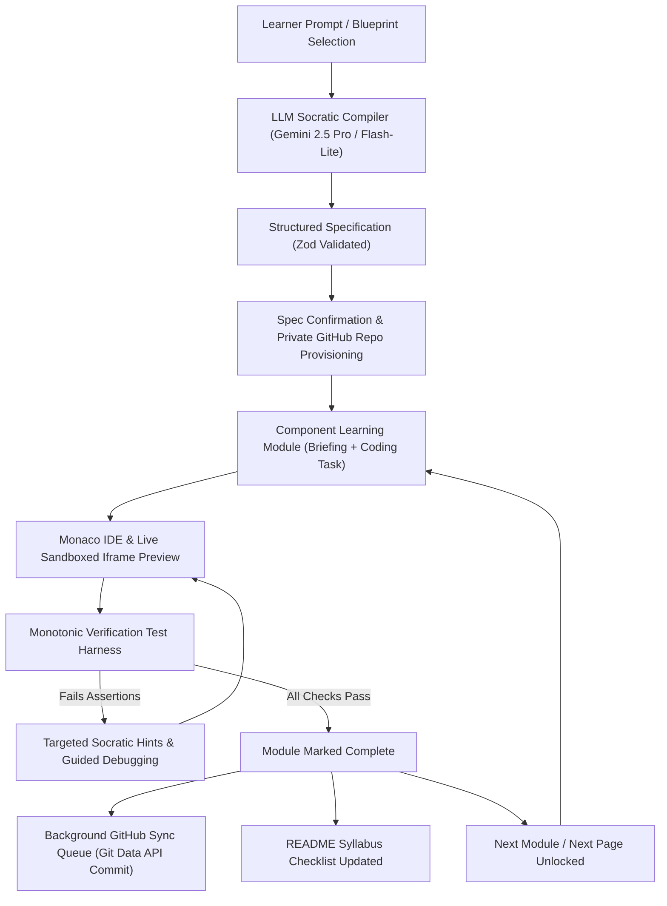

# Ascent: AI-Powered Project-Based Coding Academy

<div align="center">

[](https://nodejs.org/)
[](https://www.typescriptlang.org/)
[](https://react.dev/)
[](https://tailwindcss.com/)
[](https://expressjs.com/)
[](https://www.mongodb.com/)
[](https://ai.google.dev/)
[](https://docs.github.com/en/rest)

**The anti-tutorial-hell coding academy that architects customized engineering curriculums from your ideas, gates progress with real browser verification tests, and automatically commits verified code directly to private GitHub repositories on your personal account.**

[Key Features](#key-features) • [Architecture](#architecture-overview) • [GitHub Integration](#github-oauth--least-privilege-permissions) • [Getting Started](#development-setup) • [Testing](#testing--verification-suite) • [Deployment](#production-deployment)

</div>

---

## 1. What is Ascent?

Most developers fall into **"tutorial hell"**—passively watching videos, nodding along to code walkthroughs, yet feeling completely unable to construct a production application from a blank canvas.

Ascent fundamentally reverses this paradigm:

1. **You describe what you want to build** (e.g., *"A real-time currency exchange calculator with historical charts"*, *"An e-commerce orderbook"*, or a custom idea).
2. **Ascent synthesizes an interactive technical curriculum** broken down screen-by-screen and component-by-component using structured Gemini AI schemas.
3. **Teach-Then-Build Pedagogy**: Every module presents a conceptual engineering briefing, followed by a hands-on coding task in an in-browser Monaco IDE.
4. **Monotonic Verification Engine**: Declarative test assertions run against your live DOM in an isolated sandbox. You cannot advance until your code passes every test—no fake completions, no mock shortcuts.
5. **Real GitHub Commits**: Every verified module creates an atomic Git commit directly in a private `ASCENT-<project>` repository on your personal GitHub profile via the GitHub Git Data API, continuously updating your curriculum checklist README.

---

## 2. Key Features

- **Socratic Curriculum Compiler**: Converts freeform prompts into multi-page specifications with explicit teachable milestones, starter files, test assertions, and verified solution sets.
- **Curated Blueprint Tracks**: Instant-launch curated tracks (such as the *Greeting Login Form*, *Currency Converter*, *Rock Paper Scissors*, and *Tic Tac Toe*) with zero API key requirement.
- **In-Browser IDE & Live Sandbox**: Monaco code editor with syntax highlighting, multi-file workspace, real-time iframe preview, and client-side test assertions.
- **Automated GitHub Code Sync**: Automatically provisions a private repository named `ASCENT-<project>` upon spec confirmation. Each module completion runs an asynchronous, non-blocking background queue to commit your code and update the README checklist.
- **Bring Your Own Key (BYOK)**: User Gemini API keys are stored exclusively in the browser's local IndexedDB and forwarded per request via HTTPS headers (`x-user-api-key`). Keys are **never persisted in MongoDB**, never logged, and redacted from all traces.
- **Least-Privilege GitHub Authentication**: Secure server-side OAuth 2.0 flow with CSRF state validation, 14-day rotating sessions, and AES-256-GCM token encryption at rest.
- **Fair-Use Governance**: Unlimited curated projects. Exactly **one custom project** per learner enforced atomically in MongoDB. Custom projects may be deleted only if zero modules have been completed.
- **Activity Streak & 26-Week Heatmap**: Activity calendar, current/longest streaks, and completion statistics calculated in the learner's local timezone from immutable progress records.
- **9:16 Social Share Cards & Public Profile**: Export high-resolution vertical share cards (1080x1920) in customizable cyberpunk themes (Cyber Cyan, Terminal Green, Neon Magenta) and publish a public engineer profile at `/u/:username`.
- **Resilient Multi-Tier Reliability**: 120s client timeouts, 60s Gemini call timeouts, 110s total repair budget, exponential backoff for transient 503/429 errors, and starter file cache hashing.

---

## 3. Architecture Overview

```
┌────────────────────────────────────────────────────────────────────────┐
│                        Ascent Client (Single Page App)                 │
│                 React 19 · Vite · Tailwind CSS · Monaco Editor         │
├────────────────────────────────────────────────────────────────────────┤
│  • BYOK Key Management (Stored strictly in client-side IndexedDB)       │
│  • Local Working Copy (Debounced 30s auto-save + instant on completion)│
│  • Sandboxed Execution Iframe (Isolated DOM & Assertion Runner)        │
│  • 9:16 Canvas Social Share Card Renderer (Customizable Cyber Themes)  │
└───────────────────────────────────┬────────────────────────────────────┘
                                    │ HTTPS (Signed Cookie + x-user-api-key)
┌───────────────────────────────────▼────────────────────────────────────┐
│                         Ascent Full-Stack Server                       │
│             Node.js · Express 5 · Helmet · Rate Limiting · Zod         │
├───────────────────────────────────┬────────────────────────────────────┤
│ Auth & Security                   │ LLM Synthesis Engine               │
│ • GitHub OAuth 2.0 Server Flow    │ • GeminiProvider (BYOK Header)     │
│ • AES-256-GCM Token Encryption    │ • Multi-tier Exponential Backoff   │
│ • 14-Day Rotating Mongo Sessions  │ • 120s/60s/110s Timeout Budgets    │
│ • Zero Server-Side Key Persistence│ • Schema Validation + Zod Repair   │
├───────────────────────────────────┼────────────────────────────────────┤
│ Storage & State (StorageService)  │ GitHub Git Sync Pipeline           │
│ • MongoDB Collections & GridFS    │ • Private Repo Creation (`ASCENT-*`)│
│ • Atomic 1-Custom Project Gate    │ • Git Data API (Blobs/Trees/Commit)│
│ • Resilient In-Memory Fallback    │ • Serialized Background Job Queue  │
│ • Timezone-Aware Streak Engine    │ • README Checklist Auto-Updater    │
└───────────────────────────────────┴────────────────────────────────────┘
```

---

## 4. End-to-End Product Flow



---

## 5. GitHub OAuth & Least-Privilege Permissions

Ascent requests the following OAuth scopes during GitHub authentication:

| Scope | Purpose |
| :--- | :--- |
| `repo` | Grants permission to create private repositories on the user's personal account (`POST /user/repos`) and push module commits via the GitHub Git Data API (`POST /repos/:owner/:repo/git/commits`). |
| `read:user` | Displays the learner's GitHub username, display name, and avatar in the workspace and profile. |
| `user:email` | Associates Git commits with the user's verified primary GitHub email address so commits appear on their personal contribution graph. |

> **Why the classic `repo` scope?**  
> GitHub's permission architecture does not provide a personal scope for "create private repositories only." The standard `public_repo` scope only permits creating public repositories, which would expose unfinished learner code publicly. Ascent requests `repo` solely to provision private repositories prefixed with `ASCENT-` and push verified code. Tokens are encrypted at rest with AES-256-GCM and never exposed to the browser or external logs.

---

## 6. Curated Blueprint Tracks

For learners getting started without an API key, Ascent includes four pre-built, production-grade curated tracks:

1. **Greeting Login Form**: Master form validation, real-time focus rings, input sanitization, and dynamic DOM greetings.
2. **Currency Converter**: Real-time foreign exchange math, select dropdown handlers, rate caching, and localStorage history.
3. **Rock Paper Scissors**: State machines, computer opponent randomization, streak counters, and winning condition algorithms.
4. **Tic Tac Toe**: 2-player turn-based grid algorithms, win-state matrices, and reset flows.

---

## 7. Environment Configuration

Create a `.env` file by copying `.env.example`:

```bash
cp .env.example .env
```

| Variable | Required | Description | Default |
| :--- | :---: | :--- | :--- |
| `PORT` | Optional | Server listening port | `3000` |
| `APP_URL` | **Yes** | Canonical application origin | `http://localhost:3000` |
| `MONGODB_URI` | **Yes** | MongoDB connection string (local or Atlas) | `mongodb://localhost:27017/ascent` |
| `GITHUB_CLIENT_ID` | **Yes** | GitHub OAuth Application Client ID | — |
| `GITHUB_CLIENT_SECRET` | **Yes** | GitHub OAuth Application Client Secret | — |
| `SESSION_SECRET` | **Yes** | Secret for signing HTTP session cookies (min 32 chars) | — |
| `TOKEN_ENCRYPTION_KEY` | **Yes** | 32-character key for AES-256-GCM token encryption | — |
| `GEMINI_MODEL` | Optional | Model identifier for generation | `gemini-3.1-flash-lite` |
| `GEMINI_API_KEY` | Optional | Server-level key for dev testing/verification | — |

---

## 8. Development Setup

### 1. Prerequisites
- **Node.js**: `20.x` or `22.x`
- **npm**: `10.x` or higher
- **MongoDB**: Local `mongod` instance or MongoDB Atlas cluster (a resilient in-memory fallback engages automatically if MongoDB is not detected during dev).
- **GitHub OAuth App**: Registered in [GitHub Developer Settings](https://github.com/settings/developers) with:
  - Homepage URL: `http://localhost:3000`
  - Authorization callback URL: `http://localhost:3000/api/auth/github/callback`

### 2. Installation
```bash
git clone https://github.com/TanmayCloud251/Ascent.git
cd Ascent
npm install
```

### 3. Launch Development Server
```bash
npm run dev
```

The unified full-stack server starts on `http://localhost:3000`, simultaneously serving:
- The Express REST API and WebSocket services
- The Vite development server with live HMR

### 4. Local Dev Demo Login (No OAuth Required)
When developing locally without configuring GitHub OAuth credentials, click **"Try Demo"** or **"Explore as Demo User"** in the top navigation or landing page. This utilizes `/api/auth/dev-login` to initialize a full-fledged mock engineer session instantly.

---

## 9. Testing & Verification Suite

Ascent includes automated unit and integration tests covering security, storage, resilient LLM retries, and analytics:

```bash
# Run complete test suite
npx tsx --test tests/slice7Integration.test.ts tests/learnerStats.test.ts tests/moduleContentRobustness.test.ts
```

### Test Suite Highlights:
- **`slice7Integration.test.ts`**:
  - AES-256-GCM authenticated cipher encryption & decryption roundtrip.
  - 14-day rotating session management in MongoDB.
  - Atomic enforcement of the exactly ONE custom project rule.
  - Custom project deletion validation (allowed at 0 modules; locked once progress is made).
  - BYOK header resolution and key redaction across logs.
  - Public profile visibility toggles (`isPublic: true/false`).
- **`learnerStats.test.ts`**:
  - Streak computation, timezone midnight boundary calculations, and 26-week calendar heatmap aggregations.
- **`moduleContentRobustness.test.ts`**:
  - Client (120s) and server (60s/110s) timeout budget enforcement.
  - Automatic exponential backoff retry for transient network errors (HTTP 429, 500, 502, 503, 504).
  - Immediate failure propagation for non-retryable errors (HTTP 400/401/403/safety).
  - Deterministic starter file content hashing for prefetch cache invalidation.

---

## 10. Project Structure

```
Ascent/
├── curated-projects/           # Pre-built curated tracks (HTML/CSS/JS)
│   ├── login-greeting/         # Interactive Greeting Login Form
│   ├── currency-converter/     # Live exchange rate calculation
│   ├── rock-paper-scissors/    # Interactive AI game
│   └── tic-tac-toe/            # Turn-based grid algorithms
├── public/                     # Static assets and curated media
├── src/                        # Frontend Single-Page Application
│   ├── components/             # Reusable UI components
│   │   ├── ApiKeyModal.tsx     # BYOK Gemini key modal & validation
│   │   ├── ConsentExplainerModal.tsx # GitHub OAuth consent & setup dialog
│   │   ├── Header.tsx          # System navigation, stats, and identity
│   │   ├── LLMTracePanel.tsx   # Real-time LLM attempt & latency trace
│   │   ├── ShareCardModal.tsx  # 9:16 vertical card generator & canvas export
│   │   └── SyncIndicator.tsx   # GitHub Git Data API sync status pill
│   ├── context/
│   │   └── AppContext.tsx      # Global state, auth, and project orchestrator
│   ├── screens/                # Core application screens
│   │   ├── Screen0Landing.tsx  # Futuristic hero, blueprint preview & auth
│   │   ├── Screen1Prompt.tsx   # Command-line prompt & architecture starters
│   │   ├── Screen2Scope.tsx    # Socratic specification review
│   │   ├── Screen3ProjectOverview.tsx # Screen & syllabus breakdown
│   │   ├── Screen4Workspace.tsx# Monaco IDE, sandbox runner, and tests
│   │   ├── Screen5Projects.tsx # Learner project catalog & management
│   │   ├── Screen6Roadmap.tsx  # 26-week heatmap, streaks, and stats
│   │   ├── PublicProfileView.tsx # Public developer portfolio (/u/:username)
│   │   └── TermsPrivacyView.tsx# Data governance & privacy terms
│   └── types/                  # TypeScript interface definitions
├── tests/                      # Automated unit and integration test suite
├── server.ts                   # Full-Stack Express server & API endpoints
├── package.json                # Project dependencies and npm scripts
├── Dockerfile                  # Production multi-stage Docker container
└── README.md                   # Project documentation
```

---

## 11. Production Deployment

### Multi-Stage Docker Container
Ascent includes a production-ready, non-root Dockerfile:

```bash
# 1. Build Docker image
docker build -t ascent-academy:latest .

# 2. Run container with environment configuration
docker run -p 3000:3000 --env-file .env ascent-academy:latest
```

### Production Security Hardening
- **Helmet**: Secures HTTP response headers against clickjacking, MIME sniffing, and cross-site scripting.
- **CORS Locks**: Restricts cross-origin requests strictly to the configured `APP_URL`.
- **Express Rate Limiting**: Dedicated rate limiters on `/api/auth/*` (100 requests per 15 minutes) and `/api/llm/*` routes.
- **Health Check**: `GET /api/health` returns HTTP 200 with service status, MongoDB connectivity, and uptime.

---

## 12. License

Distributed under the MIT License. See [LICENSE](LICENSE) for more information.
